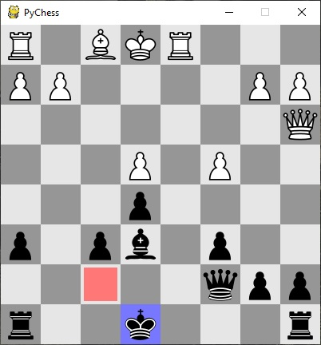
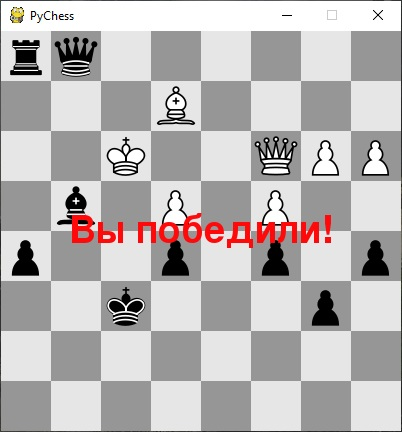
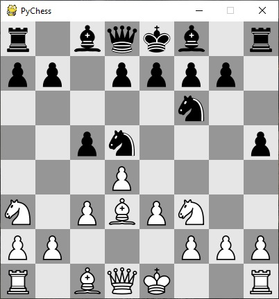
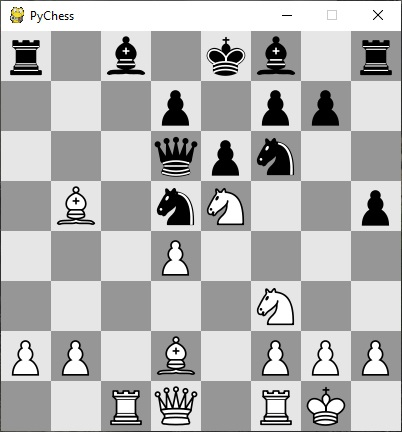
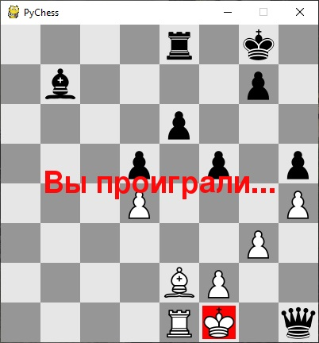

# PyChess

Простая шахматная программа. Написана на python 3 (используется библиотека pygame;
проверено на python 3.12 и pygame 2.6.1).
Для начала новой партии необходимо запустить файл start_white.pyw (играть белыми) или start_black.pyw (играть черными).
Изображения фигур — набор Cburnett (Wikimedia Commons, CC BY-SA), см. game_pack/sprites/ATTRIBUTION.md.
Файлы пакета game_pack:

- game.py
  Функции, входящие в файл необходимы для создания и работы интерфейса. Они отрисовывают доску, фигуры, доступные ходы, сообщения,           выводимые пользователю, принимают и обрабатывают щелчки мышкой.
  Каждый сделанный ход (и игрока, и компьютера) сопровождается плавным перемещением фигуры между клетками. Для этого после применения хода
  игра переходит в режим анимации, в котором проигрывается несколько кадров; скорость этих кадров задается константой ANIM_FPS, а
  длительность анимации - ANIM_DURATION (обе в params.py). Анимируются все типы ходов: обычный ход, взятие, взятие на проходе, рокировка
  (одновременно едут король и ладья) и превращение пешки.
  Если компьютер играет белыми, перед его первым ходом выдерживается небольшая пауза (константа AI_FIRST_MOVE_DELAY в params.py),
  чтобы игрок успел увидеть начальную позицию.
- params.py
  Параметры игры: цветовые константы, типы ходов, список приоритетов фигур и т.д.
  
- figures.py
  Файл содержит классы, описывающие шахматные фигуры. Все они унаследованы от одного общего класса Figure (в свою очередь унаследованного   от pygame.sprite.Sprite), содержащего код, необходимый для хранения координат фигур и их перерисовки. Каждый класс фигуры, содержит       метод get_actions, который возвращает список клеток, на которые могла бы походить фигура.
  
- boards.py
  Содержит классы, необходимые для представления игрового поля (Board), ходов (Move) и селектора фигур (SelectorBoard), используемого при   выборе фигуры, на которую следует заменить пешку, дошедшую до края поля.
  Самый сложный и функциональный из них - Board. Он представляет игровое поле и действия на нём. Board содержит методы для получения         списка доступных на поле ходов, применения ходов и их отката, а так же оценки текущей позиции. 
  При получении списка доступных ходов учитывается возможность рокировки (как левой, так и правой), взятия пешки на проходе, конверсии       пешки в другую фигуру. Также ходы фильтруются и отбрасываются те, которые ведут к шаху собственному королю (например, ходы, открывающие   удар дальнобойным фигурам противника).
  При получении оценки текущей позиции учитываются относительная сила отдельных фигур (конь ценнее пешки, ферзь ценнее коня), позиция       фигур на доске (слонам предпочтительно занять главные диагонали, коням предпочтительно быть как можно ближе к центру поля и т.д.),         защита своих фигур и атака на чужие (напрмер, чем больше фигур противника находится под ударом, тем сильнее ваша позиция).
  
- ai.py
  В файле содержится код, необходимый для расчета ответного хода компьютера. Использован алгоритм негамакс с отсечением alpha-beta. Дополнительно применяется поиск взятий на листьях дерева (quiescence search), что позволяет
  избежать ошибок оценки на незавершенных разменах, и итеративное углубление с ограничением по времени: глубина наращивается до тех пор, пока
  не исчерпан заданный бюджет времени (по умолчанию около 2 секунд на ход), после чего возвращается лучший ход последней завершенной итерации.
  Порядок просчета ходов оптимизирован: вначале оцениваются ходы-взятия (с учетом ценности жертвы и атакующей фигуры), а также ход, оказавшийся
  лучшим на предыдущей итерации углубления. Параметры поиска (бюджет времени и максимальная глубина) заданы константами AI_TIME_BUDGET и
  AI_MAX_DEPTH в params.py.
  Расчет хода выполняется в отдельном потоке, поэтому во время раздумий компьютера окно остается отзывчивым и отображает сообщение
  "Компьютер думает...".
  
Скриншоты приведены ниже

